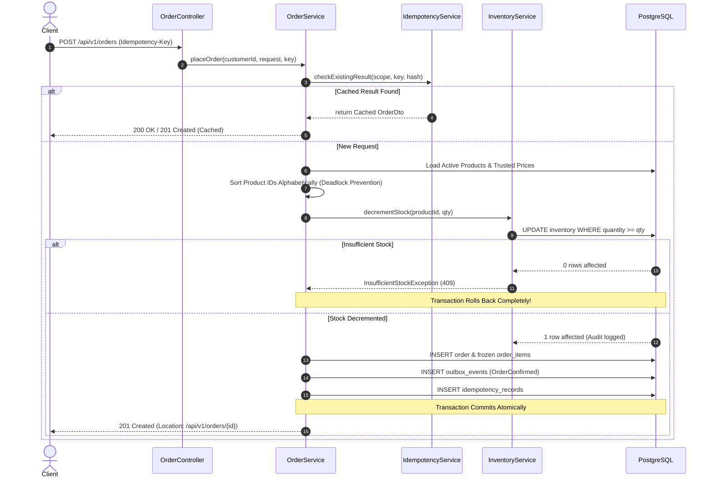

# StockFlow — Resilient Order & Inventory Backend

[](https://openjdk.org)
[](https://spring.io/projects/spring-boot)
[](https://www.postgresql.org)
[](docker-compose.yml)
[](src/test)
[](LICENSE)

StockFlow is a production-grade, portfolio-ready order and inventory backend designed to solve the critical concurrency and reliability challenges of high-throughput e-commerce platforms: **preventing overselling**, **guaranteeing zero negative stock**, **idempotent order retries**, and **atomic transactional outbox event publishing**.

---

## 🎯 Engineering Problem & Invariants

In high-concurrency commerce, naive implementations suffer from:
1. **Overselling / Race Conditions**: Two concurrent buyers purchasing the final unit can push inventory negative if read-modify-write cycles are uncoordinated.
2. **Double Deductions on Network Retry**: Transient client timeouts lead to retries, creating duplicate orders and billing customers twice.
3. **Dual-Write Inconsistency**: Committing a database order while separately failing to publish a message event leaves data and downstream services out of sync.

### Guaranteed System Invariants:
- 🛡️ **Zero Negative Stock**: Guaranteed via atomic conditional database updates (`UPDATE inventory SET quantity = quantity - :qty WHERE product_id = :id AND quantity >= :qty`).
- 🔁 **Deterministic Idempotency**: Order requests with identical `Idempotency-Key` and payload return the original order without creating duplicate orders or double-decrementing stock.
- 📦 **Immutable Snapshots**: Order lines freeze SKU, product name, and unit price at time of purchase to ensure historical audit integrity.
- 📬 **Atomic Transactional Outbox**: Business state changes and event dispatch intent commit atomically in a single PostgreSQL transaction.

---

## 🏗️ Architecture & Module Structure

StockFlow is structured as a **modular monolith** with explicit domain boundaries:

```
com.stockflow
├── common          # Security, JWT, ErrorResponse, CorrelationId, Observability
├── auth            # User identity, registration, BCrypt hashing, JWT tokens
├── product         # SKU normalization, catalogue management, price integrity
├── inventory       # Quantity tracking, conditional decrements, audit history
├── order           # Order lifecycle, line snapshots, deterministic locking
├── idempotency     # Scoped request hashing (SHA-256), replay caching
└── outbox          # Transactional event persistence & scheduled publishing
```

### Order Placement Sequence Flow



---

## ⚙️ Quickstart & Local Setup

### Prerequisites
- Java 21+
- Maven 3.9+ (or included `./mvnw`)
- Docker & Docker Compose (optional, for multi-container deployment)

### 1. Run Locally (In-Memory H2 Mode)
```bash
git clone https://github.com/ajayvarmaboya/stockflow.git
cd stockflow
./mvnw spring-boot:run
```
*The service automatically seeds demo users and catalogue items, listening on `http://localhost:8080`.*

### 2. Run with Docker Compose (PostgreSQL)
```bash
cp .env.example .env
docker compose up --build
```

---

## 🧪 Automated Test Suite

StockFlow includes 18 comprehensive tests covering unit logic, integration flows, concurrent races, and security:

```bash
./mvnw test
```

### Verified Test Matrix:
| Category | Test Name | Invariant Verified |
| :--- | :--- | :--- |
| **Concurrency** | `OrderServiceConcurrencyTest` | Two simultaneous threads competing for 1 unit; **strictly 1 succeeds**, stock remains 0. |
| **Idempotency** | `sameKeyAndSamePayload_ReturnsCachedOrder` | Network retry returns identical logical order; stock decremented only once. |
| **Idempotency** | `sameKeyAndDifferentPayload_ThrowsIdempotencyConflict` | Reusing key for different items throws `409 Conflict`. |
| **Inventory** | `adjustStock_NegativeDeltaBelowZero_ThrowsInsufficientStock` | Stock adjustments resulting in negative balance are rejected. |
| **Security** | `customerCallingAdminRoute_Returns403` | Non-admin users cannot access administrative endpoints. |
| **Security** | `customerPlacingValidOrder_Returns201` | Valid orders with JWT succeed with 201 Created. |

---

## 🔑 Demo Credentials

On startup, `DataInitializer` seeds test credentials:

| Role | Username | Password | Access Rights |
| :--- | :--- | :--- | :--- |
| **ADMIN** | `admin` | `Admin@123` | Full access (`/api/v1/admin/**`) |
| **CUSTOMER** | `customer1` | `Customer@123` | Catalogue, order placement, own order history |
| **CUSTOMER** | `customer2` | `Customer@123` | Second customer for concurrency testing |

---

## 📚 Technical Documentation & ADRs

- [Architecture & Design Guide](docs/architecture.md)
- [REST API Contract](docs/api-contract.md)
- [ADR 001: Concurrency Control Strategy](docs/adr/001-concurrency-control-strategy.md)
- [ADR 002: Idempotency Design](docs/adr/002-idempotency-design.md)
- [Operational Runbooks & Incident Response](docs/runbooks/incident-response.md)
